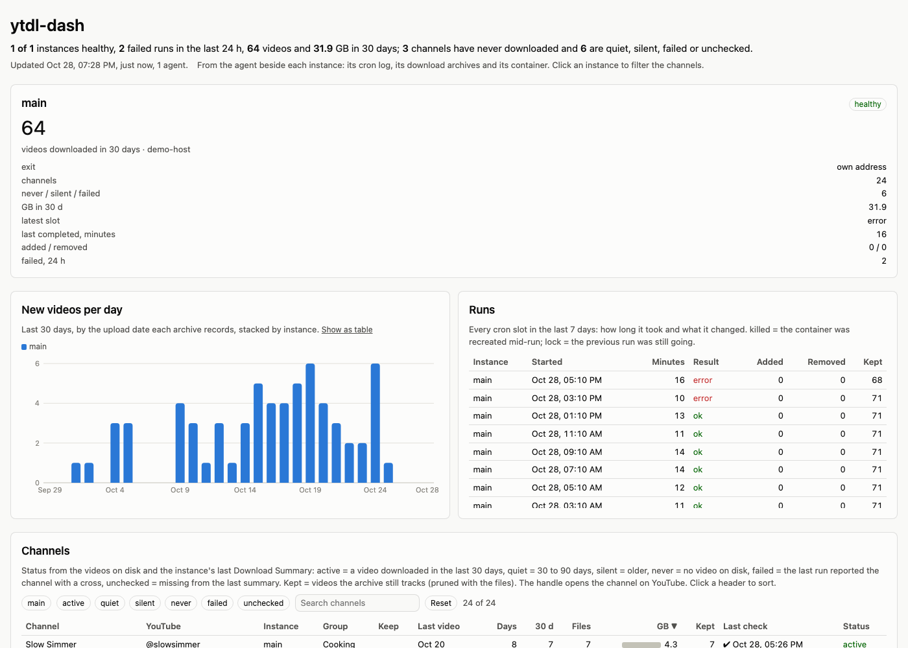

# ytdl-dash

A dashboard for one or many [ytdl-sub](https://github.com/jmbannon/ytdl-sub) instances, fed by a small **agent** that runs
beside each one. No log store, no SSH, no database: the agent reads what ytdl-sub already leaves behind, and the
dashboard asks the agents. ytdl-dash is an independent project, not affiliated with ytdl-sub.



- **Instances**: health, where the traffic exits (with gluetun), what the last run did, failures in the last day.
- **Runs**: every cron slot, how long it took, added and removed, and why it ended (ok, error, lock, timeout, killed).
- **Channels**: every subscription with what is on disk, the last run's verdict on it, and a status
  (active, quiet, silent, never, failed, unchecked); filter by instance or status, search, sort.
- **New videos per day**, stacked by instance.
- **Commands** from the dashboard, when you give the agents a token: run now, stop, reconnect the VPN, rescan.
- **Triggers**: a line in ytdl-sub's log fires an action: reconnect gluetun, restart a container, call a webhook,
  send a notification. This is the former [docker-log-watchdog](https://hub.docker.com/r/fbartolini/docker-log-watchdog),
  folded in.

## Quick start

Two files from [`deploy/`](deploy/): `compose.yaml` and `cron.sh`. The second is the run script ytdl-sub's cron
executes; it prints the markers the agent reads, and the rest of it is the usual `ytdl-sub sub` with a timeout. Put
both in a folder, write a `.env` next to them, and start:

```sh
cat > .env <<'ENV'
APPDATA=/srv/appdata          # ytdl-sub's config and the agent's state live under it
MEDIA=/srv/media/youtube      # the library
TOKEN=pick-a-long-random-one  # optional: enables the buttons
ENV
docker compose up -d
open http://localhost:8089
```

The essentials of that compose file, one ytdl-sub instance named `main` with its agent and the dashboard:

```yaml
services:
  ytdl-sub:
    image: ghcr.io/jmbannon/ytdl-sub:latest
    container_name: ytdlsub-main
    restart: unless-stopped
    volumes:
      - ${APPDATA}/main/ytdl:/config
      - ./cron.sh:/config/cron:ro                      # the run script; the agent's markers come from it
      - ${MEDIA}:/media
    environment:
      PUID: 1000
      PGID: 1000
      TZ: UTC
      CRON_SCHEDULE: "10 */2 * * *"
      CRON_RUN_ON_START: "true"

  agent:
    image: ghcr.io/mytview/ytdl-dash-agent:latest
    container_name: ytdlsub-main-agent
    restart: unless-stopped
    environment:
      INSTANCE: main
      TOKEN: ${TOKEN:-}                                # same value as the dashboard's; empty = no commands
      YTDL_CONTAINER: ytdlsub-main                     # with the socket: health, run now, stop, ytdl-sub version
    volumes:
      - ${APPDATA}/main/ytdl:/config:ro
      - ${MEDIA}:/media:ro
      - ${APPDATA}/main/agent:/data                    # the agent's run history
      - /var/run/docker.sock:/var/run/docker.sock:ro   # optional; without it the agent only observes

  dashboard:
    image: ghcr.io/mytview/ytdl-dash:latest
    container_name: ytdl-dash
    restart: unless-stopped
    ports:
      - 8089:8089
    environment:
      AGENTS: main=http://agent:9100                   # comma-separated; agents on other hosts by address
      TOKEN: ${TOKEN:-}
```

The full [`deploy/compose.yaml`](deploy/compose.yaml) adds a gluetun service, a healthcheck and the notes for more
instances: repeat `ytdl-sub` and `agent` with another name, folder and agent port, and list every agent in the
dashboard's `AGENTS`. Agents on other machines are reached by address: `AGENTS=main=http://agent:9100,second=http://192.0.2.10:9100`.

The images are `ghcr.io/mytview/ytdl-dash` and `ghcr.io/mytview/ytdl-dash-agent`, for amd64 and arm64.

## How it works

```
ytdl-sub ──writes──▶ /config/.cron.log ──tails──▶ agent ──HTTP──▶ dashboard ──▶ your browser
         ──writes──▶ /media/<channel>/.ytdl-sub-<name>-download-archive.json ──reads──▶ agent
```

The agent mounts the instance's config folder and media folder read-only and:

1. **Follows the cron log.** ytdl-sub's LinuxServer image runs `/config/cron` on a schedule and writes its output to
   `/config/.cron.log`. The script in `deploy/cron.sh` prints a marker when a run starts and when it ends (ok, with
   errors, timed out, skipped on the lock). Those markers, and the `Download Summary` table ytdl-sub prints, become the
   run history. The history is kept in the agent's own state folder, so a recreated container loses nothing.
2. **Reads the download archives.** Each subscription's archive holds the videos ytdl-sub still tracks, with their upload
   dates. That gives "kept", the last upload, the new-videos-per-day chart, and, by diffing the archive before and after
   a run, added and removed counts that do not depend on parsing any log.
3. **Measures the files.** Counts and sizes of the videos next to each archive, in total and for the last 30 and 90 days,
   which is where a channel's status comes from. The library usually sits on a network share, which charges per
   round trip rather than per byte, so the scan lists the show folders rather than walking every season, measures only
   this instance's subscriptions, and does several folders at a time. Several instances can share one library.
   `ytdl-agent scan [-subs subscriptions.yaml] /media` shows what the agent would find there and how long the share
   takes to answer.
4. **Asks around.** With the Docker socket mounted it reads the container's health and the ytdl-sub version, and can
   start or stop a run. With gluetun's control server configured it shows the exit country and city and can reconnect.

The dashboard polls every agent's `/api/all`, merges the answers, serves the page, and forwards commands with the
shared token, so the browser never holds it.

## Configuration

### Agent

| Variable | What it is |
|---|---|
| `INSTANCE` | required: the instance's name, as shown on the card |
| `TOKEN` | bearer token for commands; empty keeps every POST off |
| `YTDL_CONTAINER` | the ytdl-sub container's name; with the socket mounted: health, run, stop, version |
| `HOST` | the machine's name, shown under the card's number; default: the container's hostname |
| `GLUETUN_API_URL` | gluetun's control server, e.g. `http://ytdlsub-main-vpn:8000`; makes the VPN the exit and enables reconnect |
| `GLUETUN_API_KEY` | its API key |
| `TRIGGERS` | `match => action; match => action`, see below |

Mounts: ytdl-sub's config folder at `/config` and the library at `/media`, both read-only; a folder for the run history
at `/data`; the Docker socket, optionally.

<details>
<summary>Everything else has a default</summary>

| Variable | Default | What it is |
|---|---|---|
| `CONFIG_DIR` | `/config` | ytdl-sub's config folder: the cron log, `subscriptions.yaml`, `.last-success` |
| `LOG_FILE` | `CONFIG_DIR/.cron.log` | the log to follow |
| `SUBSCRIPTIONS` | `CONFIG_DIR/subscriptions.yaml` | the subscriptions file on disk |
| `SUBSCRIPTIONS_IN_CONTAINER` | `/config/subscriptions.yaml` | with the socket, the file is read from inside the container first, since it may be bind-mounted from elsewhere; `none` turns that off |
| `MEDIA_DIR` | `/media` | where the channel folders and archives are |
| `STATE_DIR` | `/data` | the agent's run history |
| `LISTEN` | `:9100` | address of the HTTP API |
| `DOCKER_SOCKET` | `/var/run/docker.sock` | |
| `RUN_COMMAND` | `sh -c 'bash /config/cron >> /config/.cron.log 2>&1'` | what "run now" executes in the container |
| `RUN_USER` | `abc` | the user it runs as (LinuxServer's) |
| `STOP_COMMAND` | `pkill -TERM -f [y]tdl-sub\ -l` | what "stop" executes |
| `VERSION_COMMAND` | `ytdl-sub --version` | how the ytdl-sub version is read |
| `EXIT_LABEL` | `own address` | the exit text when there is no provider |
| `TRIGGER_COOLDOWN` | `300` | seconds between firings of the same trigger |
| `RESCAN` | `30m` | archive scan while idle (it always runs after a run) |
| `HEALTH_MAX_AGE` | `6h` | without a container healthcheck, how old `.last-success` may be before unhealthy |

</details>

Actions: `gluetun-reconnect` (cycles the tunnel until the public address changes), `restart:<container>`,
`webhook:<url>` (POSTs JSON with instance, trigger, line, time; a Discord webhook URL gets `content`),
`notify:<url>` (POSTs plain text, ntfy-style, with a `Title` header), `log`.

```yaml
TRIGGERS: "Sign in to confirm => gluetun-reconnect; HTTP Error 429 => notify:https://ntfy.sh/ytdl"
```

docker-log-watchdog's `TRIGGER_STRINGS`, `RESTART_TARGET` and `RESTART_COOLDOWN` still work for a one-action setup.

### Dashboard

| Variable | Default | What it is |
|---|---|---|
| `AGENTS` | required | comma-separated agent URLs, each optionally `name=url` |
| `TOKEN` | empty | the agents' token, forwarded with commands |
| `POLL` | `60s` | how often agents are asked; the page refreshes at the same rate |
| `LISTEN` | `:8089` | |
| `TITLE` | `ytdl-dash` | |

## API

Every agent answers `GET /api/status`, `/api/instance`, `/api/channels`, `/api/runs?limit=`, `/api/daily?days=`,
`/api/log?tail=`, `/api/all` and `/healthz`; and, with a token, `POST /api/run`, `/api/stop`, `/api/reconnect`,
`/api/rescan` with `Authorization: Bearer <token>`. The dashboard serves `/data/{instances,channels,runs,daily,meta}.json`
and `POST /api/<instance>/<command>`.

## What can break, and what is done about it

The one fragile piece is reading ytdl-sub's `Download Summary` table, whose shape can change with a release. The agent
depends on it only for the per-channel tick or cross; counts come from the archives when the table is missing. The
parser lives in `internal/runlog` with real log samples in `testdata`; when the format changes, runs and counts keep
working and the per-channel verdict reads unchecked. A machine-readable run summary from ytdl-sub itself would remove
the parser entirely.

## Security

The agent is the privileged piece: the Docker socket, when mounted, is root on the host, and the gluetun key reconnects
the VPN. Run it on the same machine as its ytdl-sub, do not expose its port beyond your network, and set a `TOKEN`
only when you want the buttons. The dashboard holds nothing but the token and the agents' answers.

## License

GPL-3.0; the text is in [`LICENSE`](LICENSE).
